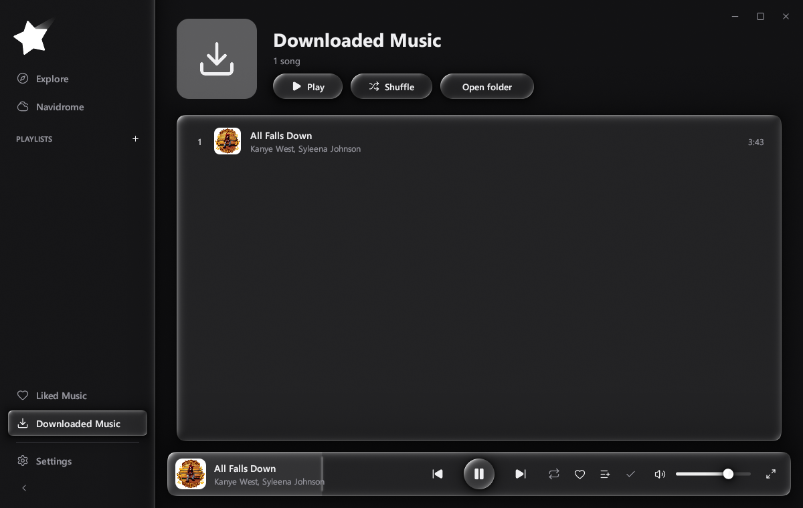
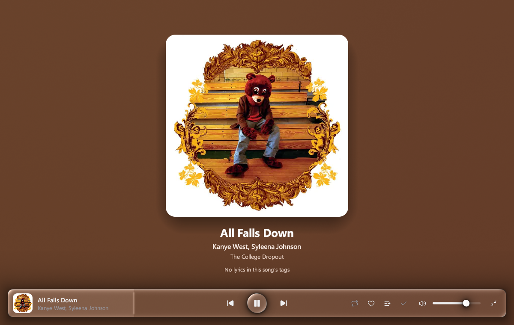
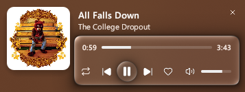
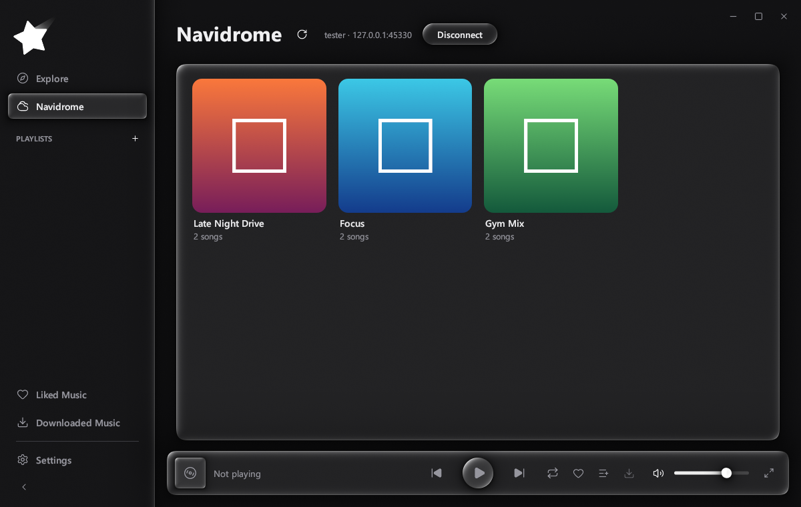
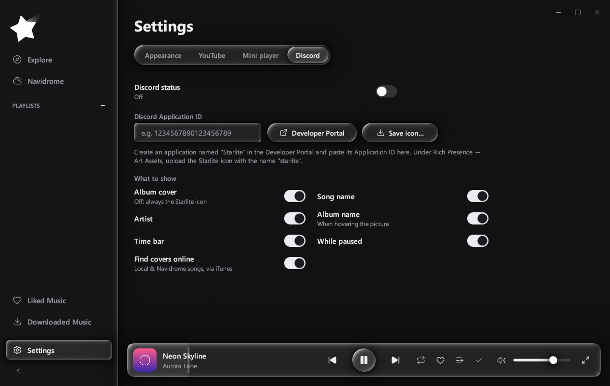

<p align="center">
  <picture>
    <source media="(prefers-color-scheme: dark)" srcset="docs/logo-white.png">
    
  </picture>
</p>

<h1 align="center">Starlite</h1>

<p align="center">
  Modern media player alternative.<br>
  <a href="https://github.com/Turtlemaxx/Starlite/releases/latest"><b>Download for Windows</b></a>
</p>

<p align="center">
  
</p>

Starlite is mainly made for your **local music** and your **Navidrome** server, but it can also be connected to **YouTube Music**.

## Features

**Full screen.** Big cover on a background made from the cover's colours. Lyrics show beside the cover and glide along with the song, lighting up word by word. They come from [lrclib.net](https://lrclib.net) (can be turned off in Settings → Lyrics), the file's tags or a `.lrc` next to it. Click a line to jump there.

<p align="center"></p>

**CD shelf.** Turn it on in Settings → Appearance and your playlists become CD cases on a bookshelf. Hover one and it slides out, turns to face you and tilts with your mouse, the disc slides out and a few seconds of the song play (its chorus when the lyrics show one).

**Search.** Every playlist has a search bar (song, artist or album; Ctrl+F).

**Sound.** Gapless playback, or a crossfade of up to 12 seconds. A 10-band equalizer with preamp, where each band's gain and width can be fine-tuned. Effects you can switch on one by one: bass, clarity, stereo widening, crossfeed, headphone surround, reverb, compressor, limiter, and output volume and balance. Speed and bass are a click away in the player bar. All of it works on your own files and server songs (YouTube plays in YouTube's player, untouched).

**Mini player.** Switch to another app (or minimize Starlite) and a small card slides out of the screen edge with the cover and song. Hover it for controls. You can move it, resize it, pick its buttons, show it only while music is playing, or turn it off in Settings.

<p align="center"></p>

**Navidrome and Jellyfin.** Connect your server and play its playlists. Right-click one to add it to your playlists in the sidebar. Songs come as they are stored, or converted by the server to MP3, AAC or FLAC at the bitrate you pick. Only a login token is saved, never your password.

<p align="center"></p>

**Discord status and Last.fm.** Shows what you're listening to on your Discord profile, and you choose what it shows: cover, song, artist, album, time. Scrobbles to Last.fm with your own API key.

<p align="center"></p>

**Themes.** Dark, Light, Cherry Blossom, Stars, Bubbles (glass bubbles that rise and pop), or your own: pick the background, accent and text colours, add a background picture, or write the look as CSS (colours, corners, blur, font). The window is simple and flat by default; liquid glass is one switch away in Settings → Appearance.

**And also:** your own playlists (start one from an .m3u file if you like), Liked Music, local files with their real tags and covers, optional YouTube Music charts (played in YouTube's official player), shuffle and loop.

**Updates.** Starlite tells you when a new version is out and installs it with one click (can be switched off in Settings → Appearance).

## Install

1. Download `Starlite-0.3.1-windows-x64.zip` from [Releases](https://github.com/Turtlemaxx/Starlite/releases/latest).
2. Unzip it anywhere and run `Starlite.exe`.

Needs 64-bit Windows 10 or 11. YouTube playback uses Microsoft Edge WebView2, which Windows 11 already has.

## Setup

- **Your music:** put MP3, FLAC, WAV, OGG or M4A files in the `Downloaded songs` folder next to the app.
- **YouTube:** Settings → Services → YouTube → paste a free [YouTube Data API key](https://console.cloud.google.com/apis/library/youtube.googleapis.com).
- **Navidrome / Jellyfin:** the first start asks for them; later it's Settings → Services → server address, username, password. Connected servers appear in the sidebar.
- **Last.fm:** create an API account at [last.fm/api/account/create](https://www.last.fm/api/account/create), paste its API key and shared secret in Settings → Services → Last.fm, press Connect and allow Starlite in your browser.
- **Discord:** create an application named "Starlite" in the [Discord Developer Portal](https://discord.com/developers/applications), paste its Application ID in Settings → Services → Discord, and upload the Starlite icon (the **Save icon…** button) under Rich Presence → Art Assets as `starlite`.

Settings, playlists and logins are stored in `%APPDATA%\Starlite`.

## Build from source

```
cargo build --release
```

Needs Rust (MSVC toolchain) on Windows. Notes on how it's built are in [docs/DEVELOPMENT.md](docs/DEVELOPMENT.md).

## Credits

Icons by [Lucide](https://lucide.dev) (ISC license, see `assets/icons/LICENSE`).
